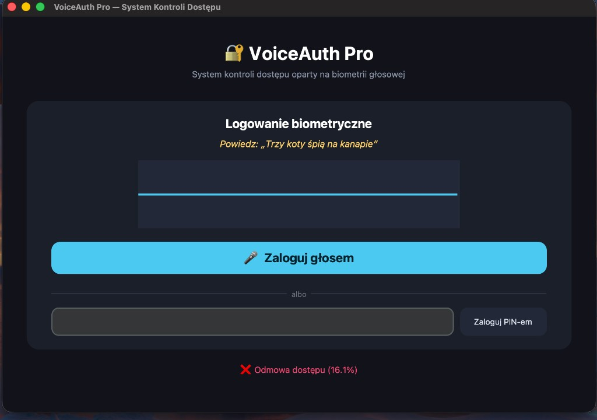
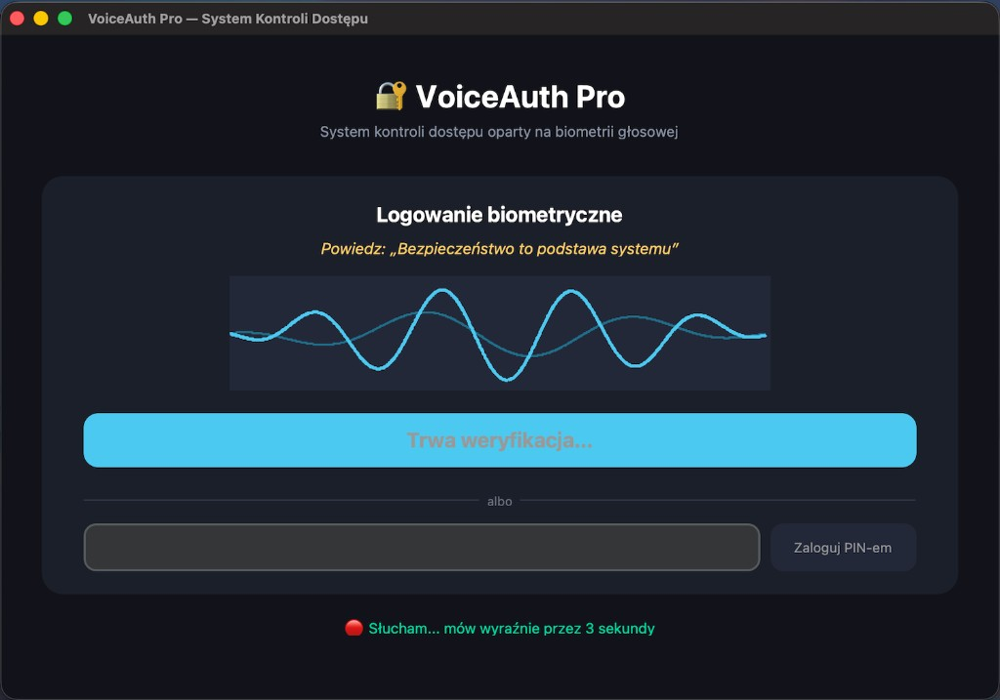
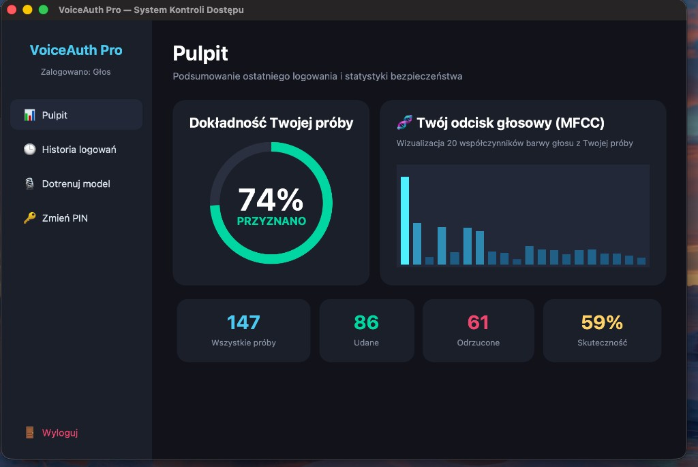
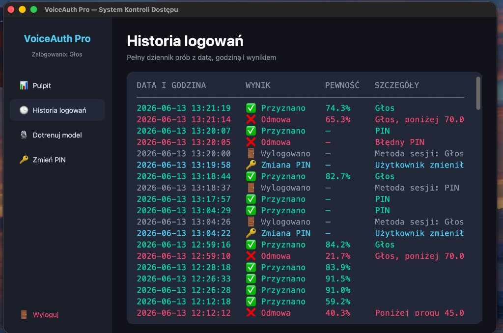
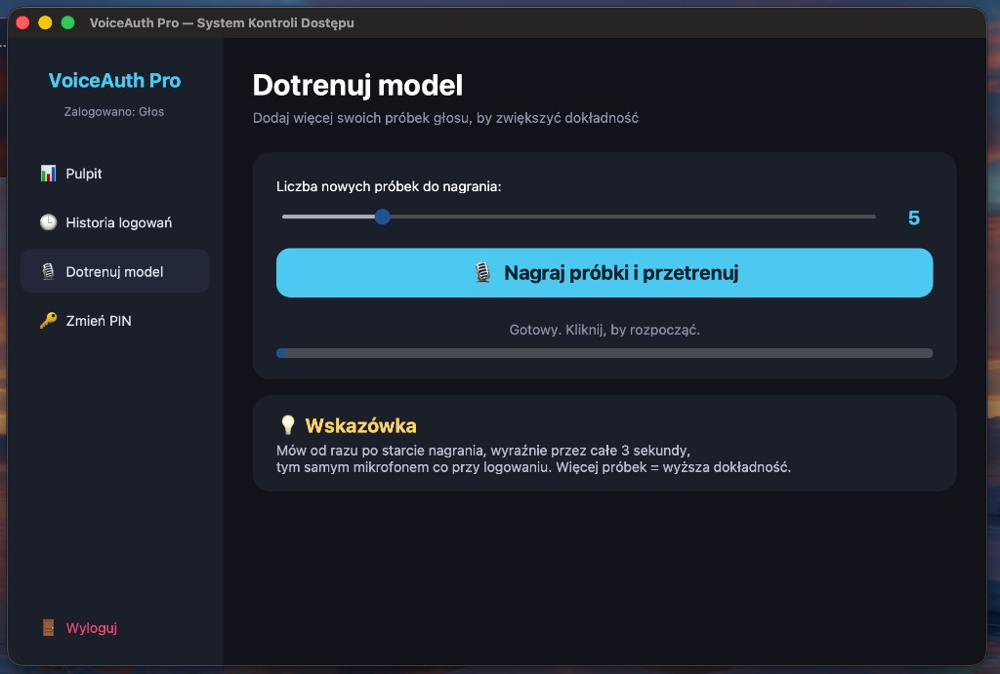
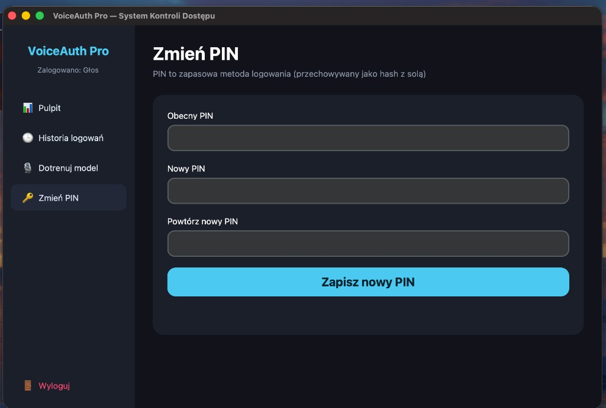

# SPRAWOZDANIE Z PROJEKTU

## Temat: System kontroli dostępu oparty na biometrii głosowej — aplikacja autoryzująca użytkownika na podstawie unikalnych cech głosu

**Przedmiot:** Bezpieczeństwo systemów komputerowych

---

## 1. Wprowadzenie i cel projektu

Celem projektu było zaprojektowanie i implementacja działającego **systemu kontroli
dostępu wykorzystującego biometrię głosową**. System uwierzytelnia użytkownika na
podstawie unikalnych cech jego głosu (barwy, charakterystyki traktu głosowego),
przyznając dostęp właścicielowi i odrzucając inne osoby — nawet o podobnym głosie,
np. członków rodziny.

Projekt obejmuje również szereg mechanizmów istotnych z punktu widzenia
bezpieczeństwa systemów komputerowych: zapasowe uwierzytelnianie kodem PIN
(przechowywanym jako hash), ochronę przed atakami brute-force (blokada czasowa),
test żywotności (anti-spoofing), wyzwanie losową frazą (challenge-response) oraz
pełny audyt zdarzeń.

---

## 2. Podstawy teoretyczne

### 2.1. Biometria głosowa
Biometria głosowa należy do biometrii **behawioralno-fizjologicznej** — głos zależy
zarówno od budowy anatomicznej (krtań, trakt głosowy), jak i sposobu mówienia.
W projekcie zastosowano klasyczne podejście **GMM-UBM** (Gaussian Mixture Model –
Universal Background Model) stosowane w systemach rozpoznawania mówcy.

### 2.2. Ekstrakcja cech — MFCC
Z nagrania wyznaczane jest **20 współczynników melowo-cepstralnych (MFCC)** w
kolejnych ramkach czasowych. Współczynniki te opisują barwę głosu w sposób zbliżony
do percepcji ludzkiego ucha. Aby zapewnić powtarzalność niezależnie od warunków:

- **przycinana jest cisza** (pauzy nie zaburzają wyniku),
- stosowana jest **normalizacja amplitudy** (głośność przestaje mieć znaczenie),
- stosowane jest **CMVN** (Cepstral Mean-Variance Normalization), które usuwa wpływ
  mikrofonu i kanału transmisyjnego.

### 2.3. Model decyzyjny
Tworzone są dwa modele mieszanin Gaussa:
- **model użytkownika** — uczony na próbkach właściciela,
- **model tła (UBM)** — uczony na głosach wielu innych osób.

Decyzja zapada na podstawie logarytmicznego ilorazu wiarygodności:

```
delta   = log P(nagranie | model_użytkownika) − log P(nagranie | model_tła)
pewność = sigmoid(delta) × 100%
```

Dostęp jest przyznawany, gdy `pewność ≥ próg` (przyjęto **70%**).

---

## 3. Architektura systemu

```
        ┌─────────────┐     MFCC + normalizacja      ┌──────────────┐
Mikrofon │  Nagranie   │ ───────────────────────────► │  Cechy MFCC  │
        └─────────────┘                                └──────┬───────┘
                                                              │
                              ┌───────────────────────────────┼───────────────┐
                              ▼                                ▼               ▼
                       Model użytkownika                  Model tła       Test liveness
                              │                                │           (anti-spoof)
                              └─────────────┬──────────────────┘
                                            ▼
                                    delta = LLR → sigmoid
                                            ▼
                                  pewność ≥ próg ?  ──► DOSTĘP / ODMOWA
                                            ▼
                                  Zapis zdarzenia do logu
```

Główne moduły:
- `app.py` — interfejs graficzny (logowanie + panel),
- `security.py` — ekstrakcja cech, liveness, PIN, blokada, audyt, historia,
- `train_model.py` — trening modeli GMM,
- `enroll.py`, `record_impostor.py`, `download_polish.py` — przygotowanie danych,
- `evaluate.py` — ewaluacja jakości (FAR/FRR/EER).

---

## 4. Mechanizmy bezpieczeństwa

| Mechanizm | Opis |
|---|---|
| Uwierzytelnianie biometryczne | rozpoznawanie mówcy metodą GMM-UBM |
| Druga metoda — PIN | przechowywany jako **hash PBKDF2-HMAC-SHA256 (100 000 iteracji) z losową solą**, nigdy jawnie |
| Ochrona przed atakami czasowymi | porównanie hashy przez `secrets.compare_digest` |
| Licznik prób + blokada czasowa | po 3 nieudanych próbach blokada 30 s (ochrona przed brute-force) |
| Test anty-spoofingowy (liveness) | wykrywa ciszę, odtworzone nagranie i syntetyczny ton na podstawie energii, dynamiki, tempa mowy i widma |
| Challenge-response | losowa fraza do wypowiedzenia przy każdym logowaniu (utrudnia atak replay) |
| Audyt zdarzeń | każde zdarzenie zapisywane z datą, godziną, wynikiem i pewnością |

**Przechowywanie danych uwierzytelniających:** PIN tylko jako hash z solą; głos jako
statystyczny model GMM, z którego nie można odtworzyć nagrania. Żadne dane
uwierzytelniające nie są przechowywane w postaci jawnej.

---

## 5. Działanie aplikacji (zrzuty ekranu)

### 5.1. Ekran logowania
Użytkownik widzi losową frazę do wypowiedzenia (challenge-response). Może zalogować
się **głosem** lub zapasowo **kodem PIN**. Poniżej widoczna odmowa dostępu dla
nieuprawnionej próby (wynik 16.1%, poniżej progu).



### 5.2. Nagrywanie i weryfikacja głosu
W trakcie nagrywania wyświetlana jest animowana fala dźwiękowa oraz komunikat
o trwającej analizie biometrycznej.



### 5.3. Pulpit — dokładność próby i odcisk głosowy
Po zalogowaniu dostępny jest pulpit z **dokładnością ostatniej próby** (wskaźnik
kołowy — tu 74%, dostęp przyznany), **odciskiem głosowym (MFCC)** oraz
statystykami bezpieczeństwa (liczba prób, udane, odrzucone, skuteczność).



### 5.4. Historia logowań
Pełny dziennik zdarzeń z datą, godziną, wynikiem, pewnością i szczegółami
(metoda logowania, powód odmowy itp.). Widać tu m.in. udane logowania głosem,
odmowy poniżej progu, logowania PIN-em, zmiany PIN i wylogowania.



### 5.5. Dotrenowanie modelu
Użytkownik może dodać własne próbki głosu bezpośrednio z aplikacji (suwak wyboru
liczby próbek) i automatycznie przetrenować model, co zwiększa dokładność.



### 5.6. Zmiana PIN
Zmiana PIN-u wymaga podania obecnego kodu i jest zapisywana jako hash z solą.



---

## 6. Testy i wyniki

### 6.1. Rozróżnianie użytkownika od innych osób (test praktyczny)
W testach z udziałem rodziny:
- **właściciel** uzyskiwał wyniki rzędu **80–96%**,
- **inni domownicy** (mama, tata) uzyskiwali wyniki **poniżej progu**,

co potwierdza skuteczne rozróżnianie nawet spokrewnionych, podobnych głosów po
dobraniu progu i wzbogaceniu modelu tła o polskie głosy.

### 6.2. Ewaluacja ilościowa (FAR / FRR / EER)
Skrypt `evaluate.py` wyznaczył standardowe metryki jakości systemów biometrycznych
(79 nagrań właściciela, 300 nagrań intruzów):

| Metryka | Wynik |
|---|---|
| Średnia pewność — właściciel | 95.2% |
| Średnia pewność — intruzi | 3.0% |
| **EER (Equal Error Rate)** | **0.00%** (przy progu 9.7%) |
| FAR przy progu 70% (intruzi wpuszczeni) | 0.00% |
| FRR przy progu 70% (właściciel odrzucony) | 1.27% |

- **FAR** (False Acceptance Rate) — odsetek intruzów błędnie wpuszczonych,
- **FRR** (False Rejection Rate) — odsetek właściciela błędnie odrzuconego,
- **EER** — punkt równowagi FAR = FRR (im niższy, tym lepszy system).

---

## 7. Wnioski

1. System poprawnie realizuje uwierzytelnianie biometryczne — odróżnia właściciela
   od innych mówców z wysoką skutecznością (EER 0% na zbiorze testowym).
2. Najważniejszą lekcją z zakresu bezpieczeństwa jest to, że **wynik EER zależy od
   reprezentatywności danych**. Idealny wynik dotyczył „łatwych" intruzów z internetu
   (inny język, inny mikrofon). W praktyce trudniejszym przypadkiem jest osoba
   spokrewniona przy tym samym mikrofonie — cechy głosu są częściowo dziedziczne,
   więc FAR rośnie. Ograniczono to, wzbogacając model tła o **polskie głosy** oraz
   umożliwiając dodanie lokalnych próbek negatywnych.
3. Dobór progu decyzyjnego to bezpośredni kompromis między **wygodą** (niski FRR)
   a **bezpieczeństwem** (niski FAR).
4. Zastosowane mechanizmy (hashowanie PIN, blokada czasowa, liveness,
   challenge-response, audyt) pokazują warstwowe podejście do bezpieczeństwa, w
   którym biometria jest tylko jednym z elementów.

### Możliwy dalszy rozwój
- adaptacja MAP modelu użytkownika z UBM (lepsze działanie przy małej liczbie próbek),
- cechy delta/delta-delta MFCC,
- zaawansowana detekcja spoofingu (anti-replay, wykrywanie syntezy mowy),
- obsługa wielu użytkowników i ról.

---

## 8. Instrukcja uruchomienia

```bash
# (opcjonalnie) pobranie polskich głosów tła
pip install datasets soundfile
python download_polish.py

# trening modeli
python train_model.py

# uruchomienie aplikacji
python app.py
```

Domyślny PIN: **1234** (do zmiany w panelu po zalogowaniu).
Wymagane biblioteki: `librosa`, `numpy`, `scipy`, `scikit-learn`, `sounddevice`,
`joblib`, `customtkinter`, `soundfile`.
